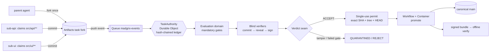

# Git4agents

**The trust layer for agent-written code.**

[](test) [](LICENSE) [](https://madgrix.ygathuku96.workers.dev)

Agents can now write code faster than anyone can review it. Branch permissions say *who* may merge, not *which exact state* earned the right to ship.
Git4agents lets any number of agents work in parallel, but only one exact commit, checked by gates nobody can override, can become canonical.
Every promotion leaves a signed bundle you can verify offline, so "it passed review" is checkable instead of a claim.

**Live:** https://madgrix.ygathuku96.workers.dev · **▶ Replay of a verified live run:** https://madgrix.ygathuku96.workers.dev/replay · **Demo video:** *coming soon* (script: [docs/VIDEO_SCRIPT.md](docs/VIDEO_SCRIPT.md)) · **Attack scenarios:** [/replay?scenario=sim](https://madgrix.ygathuku96.workers.dev/replay?scenario=sim)

---

## 60-second tour

A parent agent forks once. Sub-agents claim paths and commit on that fork. The push travels through a Cloudflare Queue to the task's Durable Object. A separate evaluation domain checks the exact candidate, blind verifiers vote, and only then does a single-use permit let that exact SHA reach canonical history.



Watch it happen with real data: **[/replay](https://madgrix.ygathuku96.workers.dev/replay)** replays the 25-entry ledger of live run `task_6cdb2087…` step by step (play, pause, speed). A second tab shows a tamperer, a false "done", a moved HEAD and an override attempt, **simulated from the test harness**.

## What happens when agents…

### …need to know what other agents are doing?
Before writing, each agent registers a **WorkClaim** (paths, symbols, intent) with the task's `TaskAuthority` Durable Object. Claims are ledgered, and overlapping claims are classified as a conflict risk. Agents read the shared picture through `GET /tasks/:id/context`, the read-only work graph at `/tasks/:id/graph`, or MCP tools (`inspect_work_graph`, `check_clearance`, `claim_work`). In the live run, `sub-api` held `src/api/**` and `sub-ui` held `src/ui/**` on one fork.

### …make conflicting changes?
The parent combines lane commits with a per-file three-way merge. Disjoint edits become one **COMPOSED** commit. Overlapping lines become **CONFLICTED**: no commit is written and neither side is dropped. Only a **RESOLVED** commit can then be evaluated. A conflicted composition admits no evaluation, permit or promotion. If canonical HEAD moves after a permit is issued, the permit expires (`EXPIRED_HEAD_MOVED`). The candidate has to be rebased into a new SHA and re-earn its evidence.

### …need everything they produce reviewed?
Machines review, and nobody can talk them out of it:
- An **independent evaluation domain** runs hidden tests, regressions and policy checks on the immutable candidate. Mandatory gates are non-compensatory: a failed gate loses even with perfect scores and a unanimous verifier vote.
- **Blind verifiers** commit to their references *before* candidates exist, then reveal and sign (commit-then-reveal).
- **Tamperers are quarantined mechanically**: modifying evaluation files taints the bundle and revokes the contender's write token.
- **TheUstad** done-check: the combined commit must sit on the frozen baseline with a clean parent, or it is `FINAL FALSIFIED` and nothing is written.

People handle escalations (ambiguity, trade-offs). Promotion stays blocked while a task is escalated, and no operator path can override an integrity gate.

### …need to know why a change was made?
Each task keeps a hash-chained ledger: intent, claims, composition, evidence, verdict, permit and promotion. The authority signs a DSSE/in-toto bundle for the exact promoted SHA. `npm run verify` checks it offline against a pinned key. `GET /tasks/:id/why/:sha` returns the causal proof graph that answers *why did this exact SHA have the right to become canonical?*

## Real numbers

| What | Result | Source |
|---|---|---|
| Live run `task_6cdb2087a04e389edc87de1c` | 9/9 steps · `concurrent_agents=3` (1 parent + 2 sub-agents) · TheUstad **FINAL VERIFIED** | live Cloudflare, [/replay](https://madgrix.ygathuku96.workers.dev/replay) |
| Promoted SHA = reviewed SHA | `fc9c1e7084ad14067012a56e68bd8f4c5bdc85c2` | signed bundle, offline `verify` → **VERIFIED** |
| Ledger | 25 hash-chained entries, from `authority_created` to `promotion_succeeded` | same bundle |
| Earlier verified run | `task_0090714a2ca6e6c167ec410a` → promoted `3b71d3a` | [docs/LIVE_RUN_RESULTS.md](docs/LIVE_RUN_RESULTS.md) |
| Big-crew live run `task_99f82dca34d72b85dc1ee92a` | **13 agents committing** (1 parent + 12 sub-agents, one fork) on `ext-ky` (sindresorhus/ky, MIT) → TheUstad **FINAL VERIFIED**, promoted `d5bcf01`, offline `verify` → **VERIFIED** | [docs/SCALE.md](docs/SCALE.md) |
| Live cheater run `task_6dce45beed286be0230b754e` | 3 sibling contenders on `ext-ky`: `cheater-cal` edited `test/base-url.ts` → evaluator `no_eval_tampering=false`, `scope_compliance=false` → ledger #19 `contender_quarantined` (trigger `eval_file_modification`, recovered from the public payload hash); `false-done-fay` said done, hidden oracle **failed**; honest `f27946233a53a3eadc0ea058ae2ee56ac683c558` promoted, offline `verify` **VERIFIED**; one-byte-tampered bundle → `ledger chain FAIL`, **NOT VERIFIED** | `node scripts/live-cheater-demo.mjs run` |
| Adversarial trials | 26/26 blocked, 0 unauthorized promotions | `npm run attack:lab` (local, real modules) |
| Module memory | second pass re-reads **25 of 184 files (13.6%)** after one edit | [docs/MODULE_MEMORY.md](docs/MODULE_MEMORY.md); vscode benchmark in [docs/MODULE_MEMORY_BENCHMARK.md](docs/MODULE_MEMORY_BENCHMARK.md) |
| Test suite | 436 tests, all passing | `npm test` |

## Scale: the coordination layer, live

One task, N scripted agents against the live Worker. Each is enrolled, claims a distinct path with its intent, and every 20th also claims its neighbour's path. Overlaps are **FLAGGED** to the claimant (risk + explanation), not refused. This is the coordination layer: **no Artifacts fork per agent** (commits go through fork crews, one fork per crew). Full method and caps: [docs/SCALE.md](docs/SCALE.md).

| N | Claims granted | Seeded overlaps flagged | False flags | p50 / p95 ms | Ledger chain |
|---|---|---|---|---|---|
| 100 | 100/100 | 4/4 | 0 | 106 / 216 | OK |
| 1,000 | 1,000/1,000 | 49/49 | 0 | 291 / 658 | OK |
| 2,000 | 2,000/2,000 | 99/99 | 0 | 593 / 1,447 | OK |
| 3,000 | 3,000/3,000 | 149/149 | 0 | 827 / 2,407 | OK |
| 5,000 | 4,997/5,000 (3 client socket resets) | 249/249 | 0 | 1,829 / 4,849 | OK |

> One Git4agents task coordinated 3,000 of 3,000 live agents (4,997 of 5,000) with every seeded path overlap flagged, zero false flags, an intact hash-chained ledger, and no fork per agent. Separately, a live crew of 13 agents committed on one fork and its combined SHA was verified and promoted.

The limit is latency on the task's single Durable Object (claims are serialized), not correctness.

## Canonicality primitives

CanonCap, causal proof graphs (`/why`), conflict capsules and the canonicality projection: see [docs/CANONICALITY.md](docs/CANONICALITY.md).

## Quick start

```bash
git clone https://github.com/YashwanthGathuku/Madgrix && cd Madgrix
npm ci
npm test              # 428 tests
npm run slice         # full protocol locally: claims → quarantine → blind verdict → permit → promote → signed bundle
npm run attack:lab    # 26 adversarial trials against the real modules
```

The live deployment and the live end-to-end harness (`npm run live:e2e`) need a Cloudflare account with Artifacts. See [docs/PRODUCTION_DEPLOYMENT.md](docs/PRODUCTION_DEPLOYMENT.md).

## What only Git4agents does

- **Blind commit-then-reveal evaluation.** Verifiers bind their references before any candidate exists.
- **Mandatory, non-compensatory gates.** No score, vote or operator overrides a failed integrity gate.
- **Mechanical quarantine.** Tampering with evaluation files quarantines the contender, taints its evidence and revokes its token.
- **Exact-SHA, single-use promotion permits.** Each permit is bound to the SHA, tree, evidence, policy and destination HEAD, and is consumed once.
- **Offline `verify` with a pinned key.** Anyone can re-check a promotion without trusting the server.
- **TheUstad done-check.** "Done" is `FINAL VERIFIED` or `FINAL FALSIFIED`, never self-reported.

## Honest limits

- Four recorded live runs are evidence, not a reliability or scale statistic. The live crew is one parent plus **two scripted sub-agents**, not LLMs.
- The `/replay` attack tab is **simulated from the local test harness**, not from live Cloudflare fault injection.
- TheUstad checks the frozen baseline and a clean parent. It is not a semantic judge of the code.
- In the live run, the first combined push was not applied, and the harness pushed again (shown in the replay). A deliberate live Queue redelivery test is not claimed.
- Evaluation-domain auth is a bearer secret, not mTLS or workload identity. Signing is Ed25519 DSSE with a pinned key, with no KMS or HSM yet.
- Fork-crew worktrees use scoped credentials but are not adversarial microVM isolation.
- The longer list is in [docs/KNOWN_LIMITATIONS.md](docs/KNOWN_LIMITATIONS.md).

## Architecture (Cloudflare products used)

| Product | Used for |
|---|---|
| **Workers** | `madgrix` Worker: REST API, `/mcp` endpoint, landing page, `/replay`, read-only work graph |
| **Durable Objects** (SQLite) | `TaskAuthority`, one per task: claims, ledger and permits in storage transactions. `ModuleAgent`: per-module memory. `PromotionContainer`: container host |
| **Queues** | `madgrix-events`: Artifacts push events, at-least-once, deduplicated per event key in the DO |
| **Workflows** | `madgrix-promotion`: one instance per permit (the permit id is the instance id), which drives the container promotion |
| **Containers** | `madgrix-promotion` image: trusted `promote.sh` / `rebase.sh`, which write only the permitted SHA |
| **Artifacts** | Git repositories: the canonical `starter-repo` and per-task contender forks with scoped tokens |

More detail is in [docs/CLOUDFLARE_ARCHITECTURE.md](docs/CLOUDFLARE_ARCHITECTURE.md) and [docs/ARCHITECTURE.md](docs/ARCHITECTURE.md). The previous long-form README, with CanonCap, the causal proof graph, conflict capsules and the full route list, is at [docs/README_FULL.md](docs/README_FULL.md).

## License

[MIT](LICENSE) © 2026 Yashwanth Gathuku
