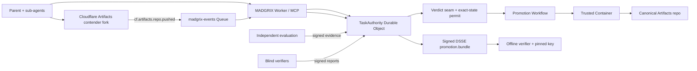
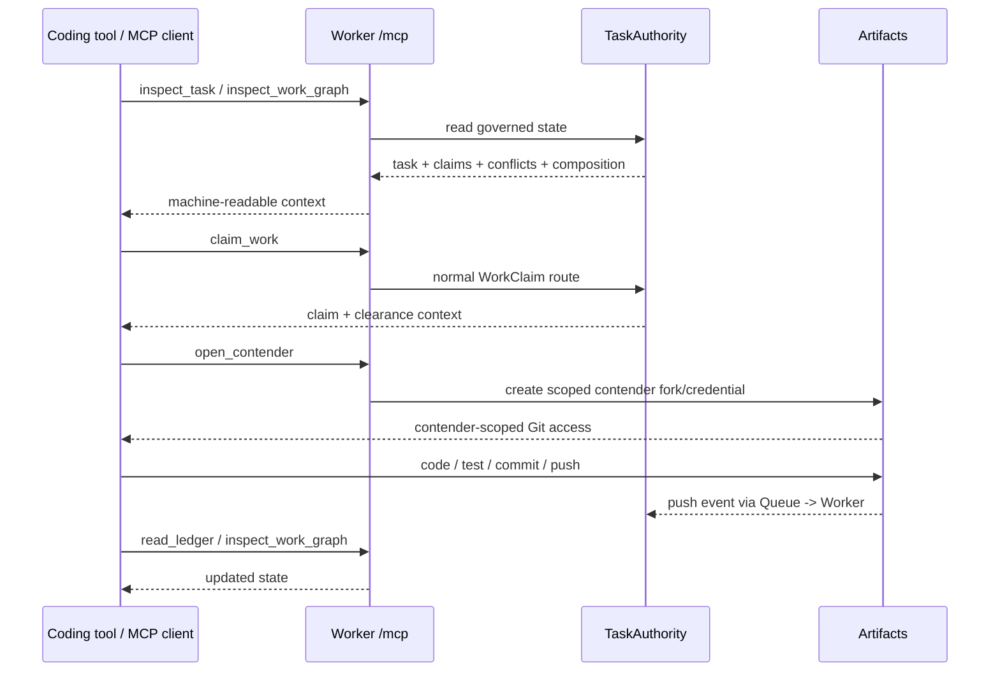

# Git4agents / MADGRIX

**The trust layer for agent-written code.**

[](test)
[](LICENSE)
[](https://madgrix.ygathuku96.workers.dev)

> **Git decides ancestry. MADGRIX decides canonicality.**

Git was designed around human developers, social review, branch permissions, and relatively small numbers of concurrent actors. Autonomous coding agents change the operating assumptions: many agents can work at once, claim completion incorrectly, modify evaluation material, race against stale state, and produce more evidence than humans can manually interpret.

**MADGRIX / Git4agents keeps Git as the content-addressed history layer, but adds an agent-native governance and canonicalization protocol around it.** Agents may create contender state; they never receive canonical write authority. Only the exact candidate that passes independent gates, blind verification, the verdict seam, and an exact-state single-use permit may become canonical. Every successful promotion produces a signed bundle that can be verified offline against a pinned key.

**Live:** https://madgrix.ygathuku96.workers.dev  
**Trust board:** https://madgrix.ygathuku96.workers.dev/board  
**＋ Bring your repo:** https://madgrix.ygathuku96.workers.dev/board/new  
**MCP endpoint:** `POST https://madgrix.ygathuku96.workers.dev/mcp`

[](https://madgrix.ygathuku96.workers.dev/)

## Why Git4agents: strongest features

Judging criteria tags: **[O]** originality · **[C]** concurrency, coordination & conflict · **[E]** ease of use.

- **Blind commit-then-reveal evaluation**: verifiers commit to references before candidates exist, then reveal and sign. **[O]**
- **Mandatory, non-overridable gates**: a failed gate loses even with perfect scores; the board's Override button answers *"Refused: mandatory gates cannot be waived"*. **[O][C]**
- **Mechanical cheater quarantine**: editing eval files taints the bundle and revokes write access; live cheater run, ledger #19 `contender_quarantined` (`eval_file_modification`). **[C]**
- **Exact-SHA, single-use signed permits**: only the reviewed commit can reach canonical history; a moved HEAD expires the permit. **[O][C]**
- **Offline verify with a pinned key**: every promotion ships a signed bundle; a one-byte-tampered copy is **NOT VERIFIED**. **[O][E]**
- **Fork crew with path claims and overlap flagging**: 13 agents (1 parent + 12 sub-agents) on ky, 12 overlaps flagged, promoted `d5bcf018194b`. **[C]**
- **3,000-agent claim scale run**: 3,000/3,000 claims granted, 149/149 seeded overlaps flagged, 0 false flags, intact ledger chain. **[C]**
- **Module memory cards**: one card per module, held by per-module Durable Object agents that sleep between requests and wake on routed changes; a second pass re-read 25 of 184 files. **[O][C]**
- **Same-file combine**: per-file three-way merge turns disjoint edits, even in one file, into one COMPOSED commit; overlapping lines become CONFLICTED, never dropped. **[C]**
- **TheUstad done-check**: a "done" commit that is not on the frozen baseline is `FINAL FALSIFIED` and nothing is written. **[C]**
- **Bring any public repo into the live mall**: [/board/new](https://madgrix.ygathuku96.workers.dev/board/new) imports it, freezes a task, claims and forks per agent, and opens `/board?live=1`. **[E]**
- **All on Cloudflare**: Workers, Durable Objects, Queues, Containers, Workflows and Artifacts. **[E]**

---

## Visual guide

These diagrams map the implementation, workflow, trust boundaries, MCP surface, and measured results. They intentionally compress low-level details for readability; the linked implementation docs and code are authoritative.

### 1. Cloudflare-native architecture


Deep dive: [Cloudflare architecture](docs/CLOUDFLARE_ARCHITECTURE.md) · [system architecture](docs/ARCHITECTURE.md) · [canonicality](docs/CANONICALITY.md)

### 2. End-to-end governed promotion workflow


Deep dive: [architecture](docs/ARCHITECTURE.md) · [canonicality](docs/CANONICALITY.md) · [live results](docs/LIVE_RUN_RESULTS.md)

### 3. Human-era Git / GitHub vs Git for autonomous agents


Deep dive: [canonicality primitives](docs/CANONICALITY_PRIMITIVES.md) · [prior-art boundary](docs/CANONICALITY_PRIOR_ART.md)

### 4. Use cases, actors, and trust boundaries


Deep dive: [architecture](docs/ARCHITECTURE.md) · [production deployment](docs/PRODUCTION_DEPLOYMENT.md) · [known limitations](docs/KNOWN_LIMITATIONS.md)

### 5. MCP in real time


Deep dive: [MCP agent tools](docs/MCP_AGENT_TOOLS.md) · [module memory](docs/MODULE_MEMORY.md)

### 6. Evidence, testing, and real results


Deep dive: [live run results](docs/LIVE_RUN_RESULTS.md) · [scale](docs/SCALE.md) · [module memory](docs/MODULE_MEMORY.md)

> **Accuracy note:** the current live signing path is **Ed25519 + DSSE with an out-of-band pinned public key**. KMS/HSM/Sigstore-backed production key management is future hardening. MCP exposes exactly seven agent-safe tools and deliberately exposes no `promote`, verdict, permit-issuance, evidence-submission, or canonical-write authority.

---

## From human Git to Git for agents

Traditional Git remains excellent at immutable snapshots, ancestry, branching, merging, and distributed transport. GitHub adds collaboration, pull requests, permissions, CI, and social review. Those primitives remain useful, but several assumptions change when autonomous agents become first-class software actors.

| Human-era model | Agent-era problem | MADGRIX primitive |
|---|---|---|
| A small number of developers coordinate through branches and PRs | Hundreds or thousands of agents can act concurrently | **WorkClaims** + shared work graph expose intent, scope, ownership, and interactions before code lands |
| Branch permissions answer **who may merge** | An allowed actor can still produce wrong, stale, or unevaluated state | **CanonCap / exact-state permit** binds authority to one exact task, baseline, candidate, evidence, policy, and destination HEAD |
| Human reviewers infer intent and trust from discussion | Agents can falsely claim `done` or produce plausible but incorrect summaries | **Frozen task + independent evaluation + TheUstad baseline gate** separate claims from evidence |
| CI usually runs after branch/PR state exists | An agent may modify tests/evaluation material to make itself look correct | **Independent evaluation domain** + `no_eval_tampering` + mechanical quarantine |
| Merge conflicts are discovered at line/merge time | Concurrent agents can overlap semantically before Git sees a line conflict | **Semantic clearance / conflict reports** flag path, symbol, contract, state, and impact interactions |
| Merge permission is reusable actor authority | Agent-era promotion needs one-shot, state-specific authority | **Single-use exact-state permit**; destination HEAD movement expires old authority |
| Git history proves what changed | It does not prove why a state earned the right to ship | **Hash-chained ledger + causal proof graph + signed DSSE bundle** |
| Human review is the final trust boundary | Human review cannot scale to every high-frequency agent action | **Machine-enforced non-compensatory gates**, with humans reserved for ambiguity/escalation rather than integrity overrides |

```text
Human Git:     identity / branch permission -> review -> merge
Git4agents:    intent -> bounded work -> evidence -> verdict -> exact-state authority -> canonicalize -> prove
```

**Git records what changed. MADGRIX records why work began, what authority existed, what was checked, why a state was authorized, and whether the exact reviewed state is the exact state that shipped.**

---

## Core Git-for-agents primitives

| Primitive | What it adds |
|---|---|
| **Frozen task** | Pins intent, baseline commit, policy version, and behavior contract before work begins |
| **WorkClaim** | Declares agent intent, baseline, paths, symbols, contracts, interfaces, schema changes, expected tests, and lease |
| **Semantic clearance** | Projects stored conflict reports as `CLEAR`, `CAUTION`, `HOLD`, or `REVIEW`; advisory only, never a permission grant |
| **Contender / fork crew** | Isolates agent-produced state from canonical Git; fork crews let many sub-agents work on one governed contender fork |
| **Composition state** | `COMPOSED`, `CONFLICTED`, and `RESOLVED` distinguish a promotable candidate from unresolved multi-agent work |
| **Independent evaluation** | Checks immutable candidate state for exact baseline, scope, tampering, hidden oracle, regressions, static analysis, security, semantics, and provenance |
| **Blind verification** | Verifiers commit references before candidate exposure, then reveal once and sign reports |
| **TheUstad gate** | In the fork-crew path, checks the parent is clean and still on the frozen baseline before composition; it is not the semantic judge |
| **Verdict seam** | Runs non-compensatory integrity gates first; then objective ordering and blind verification |
| **CanonCap / exact-state permit** | One content-bound, single-use right to canonicalize one exact state under one exact destination HEAD |
| **Conflict Capsule** | Makes `CONFLICTED` explicitly non-shippable and requires a new resolved SHA plus re-evaluation |
| **Causal Proof Graph** | Answers: *why did this exact SHA have the right to become canonical?* |
| **Signed promotion bundle** | DSSE/in-toto evidence chain signed by TaskAuthority and independently verifiable offline |
| **Module memory** | Deterministic, model-free per-module memory cards so unchanged modules do not need to be reread on every pass |

More: [CANONICALITY.md](docs/CANONICALITY.md) · [CANONICALITY_PRIMITIVES.md](docs/CANONICALITY_PRIMITIVES.md) · [MODULE_MEMORY.md](docs/MODULE_MEMORY.md)

---

## Cloudflare is the runtime, not a logo on top

MADGRIX uses Cloudflare primitives as distinct trust and execution roles rather than putting the whole system in one service.

| Cloudflare primitive | MADGRIX role |
|---|---|
| **Workers** | Public HTTP control plane, REST routes, `/mcp`, `/board` (+ live mode, `/board/new`), graph views, Queue consumer, auth boundary |
| **Durable Objects — `TaskAuthority`** | Per-task authoritative state: frozen task, WorkClaims, conflict reports, evaluations, ledger, verdicts, permits, and promotion records |
| **Durable Objects — `PromotionContainer`** | Hosts/coordinates the trusted promotion runtime path |
| **Durable Objects — `ModuleAgent`** | Deployed per-module memory owner; stores deterministic module cards and wake metadata |
| **Artifacts** | Real Git substrate: baseline/canonical repository plus contender forks and scoped Git credentials |
| **Queues — `madgrix-events`** | Receives real `cf.artifacts.repo.pushed` events and feeds them into TaskAuthority with deduplication |
| **Workflows — `madgrix-promotion`** | One durable promotion instance per permit; instance id is the permit id |
| **Containers — `madgrix-promotion`** | Trusted `promote.sh` / `rebase.sh` writer; only this path can write canonical Git state |
| **Worker secrets** | Control, agent, and evaluation service tokens plus authority signing key; secret values are not stored in the repository |

### Live path



**Authority separation matters:** contenders can write only their contender workspace; evaluation gets read-only candidate access; verifiers do not get repo authority; the trusted promotion path is the only canonical writer.

See [docs/CLOUDFLARE_ARCHITECTURE.md](docs/CLOUDFLARE_ARCHITECTURE.md) for current live deployment state and [docs/ARCHITECTURE.md](docs/ARCHITECTURE.md) for the five trust zones and full protocol flow.

---

## How a governed task flows

1. **Freeze intent and baseline.** `POST /tasks` pins intent, baseline commit, policy, and enrolled identities.
2. **Commit verifier references before candidates exist.** Blind verifiers pre-commit their references.
3. **Create bounded contender state.** Parent opens one governed Artifacts fork for a fork crew.
4. **Claim before coding.** Sub-agents register scoped WorkClaims with intent and lease.
5. **Work concurrently.** Agents commit lane changes to contender state, not canonical Git.
6. **Compose.** Disjoint edits become `COMPOSED`; unresolved overlaps become `CONFLICTED`; resolution creates a new SHA.
7. **Observe the real Git push.** Artifacts emits a push event; Queue delivers it; TaskAuthority reconciles it into authoritative state.
8. **Evaluate the immutable candidate.** Mandatory gates run in the independent evaluation domain.
9. **Blind verifiers reveal and sign.** Invalid reveal is inadmissible; reports cannot be rewritten after seeing outcomes.
10. **TheUstad checks the frozen-baseline condition** for the fork-crew parent.
11. **Verdict seam decides eligibility.** Integrity gates are non-compensatory; no weighted score rescues a failed mandatory gate.
12. **Issue exact-state authority.** ACCEPT creates a single-use permit bound to candidate/evidence/policy/destination state.
13. **Promote the reviewed SHA itself.** Workflow + Container fast-forward canonical only if expected destination HEAD still matches.
14. **Sign and verify history.** TaskAuthority signs the promotion bundle; anyone with the pinned public key can verify it offline.

If destination HEAD moves after authority is issued, the old permit becomes `EXPIRED_HEAD_MOVED`; the candidate must be rebased into a **new SHA**, re-evaluated, and re-authorized.

---

## MCP: agent-native access without an authority bypass

MADGRIX exposes a stateless Model Context Protocol adapter at:

```text
POST /mcp
```

MCP is a convenience and interoperability surface over the same Worker router and `TaskAuthority` state machine used by REST. It does **not** create a second authority plane. Existing bearer authentication and `X-Madgrix-Agent-Secret` checks still apply.

### Exact agent-safe MCP tools

| Tool | Purpose | Authority effect |
|---|---|---|
| `inspect_task` | Read frozen task, claims, contenders, conflicts, and composition context | Read only |
| `inspect_work_graph` | Read the structured canonical WorkGraph | Read only |
| `check_clearance` | Summarize stored WorkClaim interactions as `CLEAR` / `CAUTION` / `HOLD` / `REVIEW` | Advisory only |
| `claim_work` | Register intent, baseline, scope, contracts, interfaces, schema changes, expected tests, and lease | Creates a normal WorkClaim |
| `open_contender` | Open the authenticated agent's isolated Cloudflare Artifacts contender fork | Returns contender-scoped credential only |
| `read_ledger` | Read the append-only hash-chained authority ledger | Read only |
| `verify_permit` | Verify a stored exact-state permit against bound fields and current destination HEAD | Check only; cannot issue or consume |

### Deliberately absent from MCP

```text
promote
verdict
evidence submission
composition authority
rebase authority
finalize
issue_permit
canonical write
```

That omission is intentional: a coding client can discover work, claim scope, inspect the graph, open contender state, and verify authority, but cannot turn MCP into a privilege-escalation path.

### Real-time loop



Modern protocol discovery, auth headers, wire examples, and deployment checks: [docs/MCP_AGENT_TOOLS.md](docs/MCP_AGENT_TOOLS.md).

---

## Trust boundaries and failure behavior

MADGRIX treats coding agents as **untrusted producers**. Trust is earned by the produced state, evidence, and exact authority chain — not by an agent saying the work is finished.

### Collaborative feature build

```text
sub-agents claim scoped work
        ↓
one governed contender fork
        ↓
COMPOSED candidate
        ↓
independent evaluation + blind verification
        ↓
exact-state permit
        ↓
PROMOTED exact SHA
        ↓
signed bundle -> offline VERIFIED
```

### Cheater / tamper attempt

```text
candidate modifies evaluation material
        ↓
no_eval_tampering = false
        ↓
contender_quarantined
        ↓
write token revoked / evidence tainted
        ↓
NO PROMOTION
```

### Stale destination race

```text
candidate evaluated -> permit issued
        ↓
canonical HEAD moves
        ↓
EXPIRED_HEAD_MOVED
        ↓
REBASE_REQUIRED
        ↓
new SHA -> new evaluation -> new permit
```

What cannot be bypassed:

- mandatory integrity gates are non-compensatory;
- an operator can resolve ambiguity or trade-offs, but cannot override an integrity failure;
- quarantine is mechanical when the configured tamper condition is proven;
- the promotion service is the sole canonical writer;
- offline proof does not require trusting the live Worker or a key embedded inside the bundle.

---

## Live Trust Board (the repo mall)

The deployed Worker includes judge-facing visualizations in addition to the protocol APIs.


[](https://madgrix.ygathuku96.workers.dev/board?scenario=cheater&autoplay=1)

The board renders each repository as a 2.5D isometric mall: agents enter through fork/enroll, claimed files map to stores, overlaps appear when multiple agents touch the same area, evaluation happens at checkout, quarantined contenders are visibly removed, and an honest promoted contender leaves with the canonical SHA. The visualization is a projection of recorded/live-safe state; underlying task ids, agent ids, claims, gates, ledger entries, and SHAs come from real MADGRIX records.

**Live mode** (`/board?live=1`, also the default with no `scenario`) polls the public-safe `GET /tasks/:id/board-state` projection. It exposes whitelisted read-only fields only; no service tokens or contender credentials are rendered.

**Open your own repo in the mall** ([/board/new](https://madgrix.ygathuku96.workers.dev/board/new)): paste a public GitHub URL, an instruction and (optionally) the paths to claim. With the demo access key, the Worker imports the repo into Artifacts (binding `import()`), freezes a real task with your instruction (`handleCreateTask`), registers one claim per agent from your instruction and forks one Artifacts repo per agent (`handleClaim` + `handleCreateContender`, the same first steps as `scripts/run-contenders.mjs`), then redirects to the live mall. It does **not** run agents; commits and gate runs come from the agent runners, and the mall shows only what the authority records. Agent secrets and fork tokens are discarded server-side. Protected by a demo key (Worker secret), a per-IP limit (1 import / 10 min, best effort) and a 20 MB repo cap. Verified end to end: `sindresorhus/is-plain-obj` (MIT) → `task_f0936a321f6c5844dd2bc2af`, 2 claims, 2 forks, 8 ledger entries.

| Crew | Scale |
|---|---|
|  |  |
| Cheater | Promoted |
|  |  |
| Price-tag card (real agent details) | Live mode (real task imported via /board/new) |
|  |  |
| /board/new: bring your repo | |
|  | |

The old `/replay` page is retired and 301-redirects to `/board`. Simulated attacks live in the local test harness (`npm run attack:lab`); the live cheater run on `/board` is the live counterpart.

---

## Evidence and measured results

### Repository / protocol evidence

| Evidence | Result | Where |
|---|---|---|
| Test suite | **446 passing** | `npm test` |
| Type checking | available | `npm run typecheck` |
| Attack lab | **26/26 blocked, 0 unauthorized promotions** | `npm run attack:lab` |
| Offline verification | signed bundles end in **VERIFIED**; tampered bundle ends **NOT VERIFIED** | `npm run verify -- --trust-key keys/authority.pub <bundle>` |
| Module memory | second pass reads **25 / 184 files = 13.6%** after one edit | [docs/MODULE_MEMORY.md](docs/MODULE_MEMORY.md) |

### Live Cloudflare proof

| Run / measurement | Result |
|---|---|
| Recorded E2E run series on `starter-repo` | four successful exact reviewed-SHA = promoted-SHA runs; TheUstad `FINAL VERIFIED`; bundle `VERIFIED` |
| 13-agent fork crew on `ext-ky` | **1 parent + 12 sub-agents**, one fork, combined candidate promoted as `d5bcf01…`, offline bundle `VERIFIED` |
| Live cheater run | `cheater-cal` changed `test/base-url.ts` -> `contender_quarantined`; `false-done-fay` failed hidden oracle; honest contender promoted; tampered bundle -> ledger chain `FAIL` / `NOT VERIFIED` |
| Live WorkClaim coordination | **3,000 / 3,000** accepted; **4,997 / 5,000** at 5K |
| Seeded overlap detection at 5K | **249 / 249 flagged**, **0 false overlap flags**, ledger chain OK |

The scale run measures the **coordination / WorkClaim layer**, not 5,000 agents each pushing Git commits. The separate 13-agent crew is the live committing/composition/promotion proof. See [docs/SCALE.md](docs/SCALE.md) for methodology and caps.

### Module memory

Module memory is deterministic and model-free. It reads the repository by module, persists one card per module, and refreshes only modules affected by a Git diff. In the recorded local demo, one edit caused only **1 of 11 module cards** to be reread: **25 of 184 files (13.6%)**. The `ModuleAgent` Durable Object is deployed, but a live Cloudflare load/wake benchmark is **not** claimed yet.

---

## Quick start — local, no Cloudflare account

Requires Node 22+ and Git.

```bash
git clone https://github.com/YashwanthGathuku/Git4agents && cd Git4agents
npm ci
npm test
npm run typecheck
npm run slice
npm run headmove
npm run demo:memory
npm run attack:lab

npm run verify -- --trust-key keys/authority.pub docs/bundles/live-run-4.bundle
npm run verify -- --trust-key keys/authority.pub docs/bundles/live-crew-13.bundle
npm run verify -- --trust-key keys/authority.pub docs/bundles/live-cheater.bundle
```

Each successful verify ends with `VERIFIED`. Modify the evidence chain and the verifier fails closed.

---

## Running the live Cloudflare flows

A live deployment needs a Worker, an Artifacts namespace with a baseline repository, the `madgrix-events` Queue and push subscription, service tokens, and the authority signing key. Use [docs/PRODUCTION_DEPLOYMENT.md](docs/PRODUCTION_DEPLOYMENT.md) and [docs/CLOUDFLARE_LIVE_READINESS.md](docs/CLOUDFLARE_LIVE_READINESS.md); never print or commit secret values.

```bash
npm run live:e2e
node scripts/live-cheater-demo.mjs run
node scripts/scale-agents.mjs --mode live --ramp 10,100,500,1000 --concurrency 25
node scripts/scale-agents.mjs --mode local --ramp 10,100,1000
```

The external demo repository `ext-ky` is `sindresorhus/ky` (MIT) imported into Cloudflare Artifacts.

---

## Documentation map

| Topic | Document |
|---|---|
| System trust zones, protocol stages, code map | [docs/ARCHITECTURE.md](docs/ARCHITECTURE.md) |
| Live Cloudflare primitives and deployment evidence | [docs/CLOUDFLARE_ARCHITECTURE.md](docs/CLOUDFLARE_ARCHITECTURE.md) |
| Canonicality, CanonCap, causal proof graph, conflict capsule | [docs/CANONICALITY.md](docs/CANONICALITY.md) |
| Canonicality primitives | [docs/CANONICALITY_PRIMITIVES.md](docs/CANONICALITY_PRIMITIVES.md) |
| Prior-art / non-novelty boundary | [docs/CANONICALITY_PRIOR_ART.md](docs/CANONICALITY_PRIOR_ART.md) |
| Exact MCP protocol surface and seven agent-safe tools | [docs/MCP_AGENT_TOOLS.md](docs/MCP_AGENT_TOOLS.md) |
| ModuleAgent / module-memory design and limits | [docs/MODULE_MEMORY.md](docs/MODULE_MEMORY.md) |
| Module-memory benchmark details | [docs/MODULE_MEMORY_BENCHMARK.md](docs/MODULE_MEMORY_BENCHMARK.md) |
| Recorded live end-to-end results | [docs/LIVE_RUN_RESULTS.md](docs/LIVE_RUN_RESULTS.md) |
| Live scale methodology, results, ceilings | [docs/SCALE.md](docs/SCALE.md) |
| 10K logical fleet proof | [docs/FLEET_10K.md](docs/FLEET_10K.md) |
| Cloudflare readiness and deployment caveats | [docs/CLOUDFLARE_LIVE_READINESS.md](docs/CLOUDFLARE_LIVE_READINESS.md) |
| Production deployment | [docs/PRODUCTION_DEPLOYMENT.md](docs/PRODUCTION_DEPLOYMENT.md) |
| Competition demo/runbook | [docs/FINAL_COMPETITION_DEMO.md](docs/FINAL_COMPETITION_DEMO.md) · [docs/DEMO_RUNBOOK.md](docs/DEMO_RUNBOOK.md) |
| Benchmark reproduction | [docs/BENCHMARK_RUNBOOK.md](docs/BENCHMARK_RUNBOOK.md) |
| Known limitations / claims boundary | [docs/KNOWN_LIMITATIONS.md](docs/KNOWN_LIMITATIONS.md) |
| Video script | [docs/VIDEO_SCRIPT.md](docs/VIDEO_SCRIPT.md) |

---

## Honest limits

- Live runs are **evidence**, not a production reliability statistic.
- Recorded live agents are **scripted processes**, not evidence of LLM coding intelligence; the project demonstrates the coordination, governance, canonicalization, and proof substrate.
- Simulated attacks run in the local test harness (`npm run attack:lab`); the live cheater run separately demonstrates live quarantine behavior.
- TheUstad in the fork-crew flow is a frozen-baseline integrity/done gate, not the semantic judge. Independent evaluation and blind verification judge the candidate.
- Overlapping WorkClaims are **flagged**, not automatically refused. Scale numbers are for the coordination layer; commits scale through fork crews rather than one fork per agent.
- One `TaskAuthority` Durable Object serializes a task; claim latency rises with N. Separate tasks use separate Durable Objects.
- Queue delivery is observed live, but a deliberate at-least-once redelivery fault-injection campaign is not claimed.
- Evaluation-domain auth currently uses bearer credentials rather than mTLS.
- Signing is Ed25519 DSSE with a pinned public key; KMS/HSM/Sigstore-backed production key management is future hardening.
- Fork-crew worktrees use scoped credentials but are not claimed as adversarial microVM isolation.
- `ModuleAgent` is deployed, but its live Cloudflare memory load/wake performance is not yet claimed.

Full list: [docs/KNOWN_LIMITATIONS.md](docs/KNOWN_LIMITATIONS.md).

---

## License

[MIT](LICENSE) © 2026 Yashwanth Gathuku
