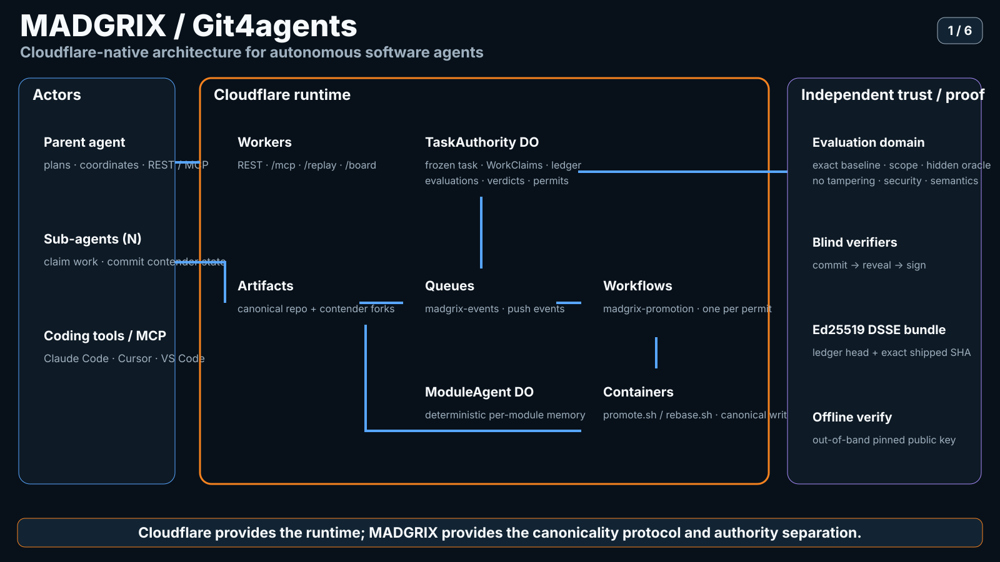
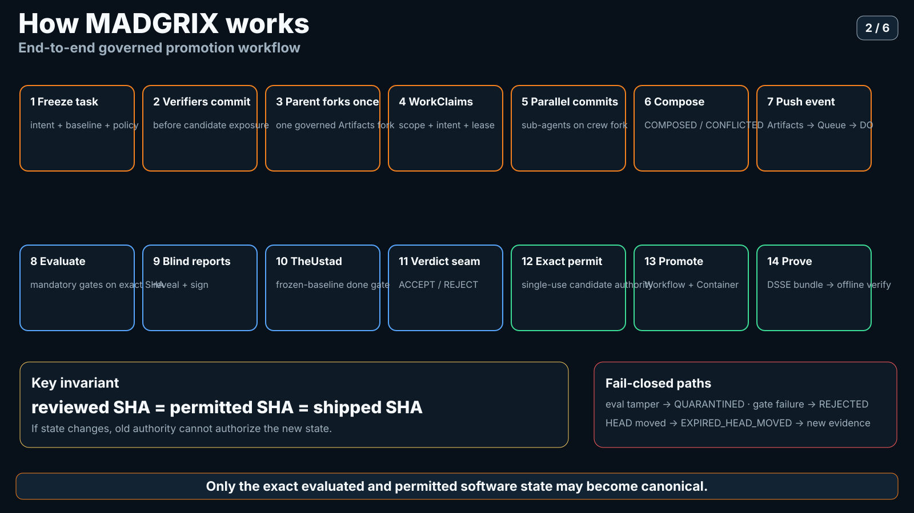
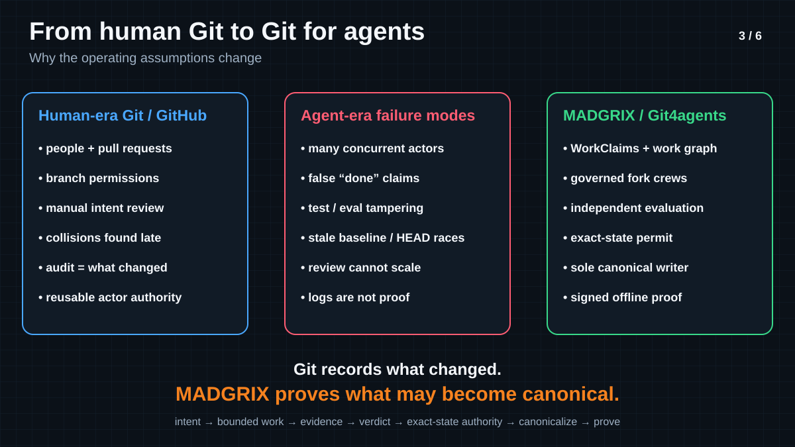
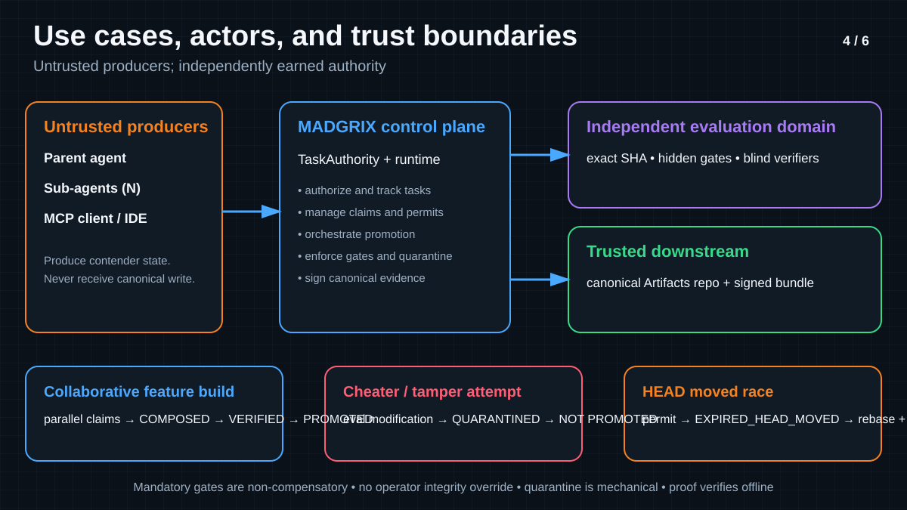
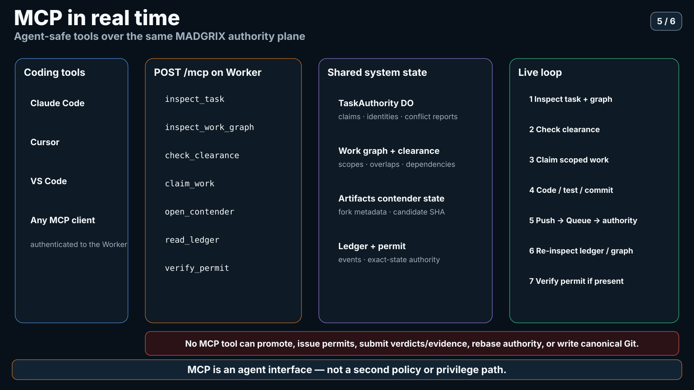
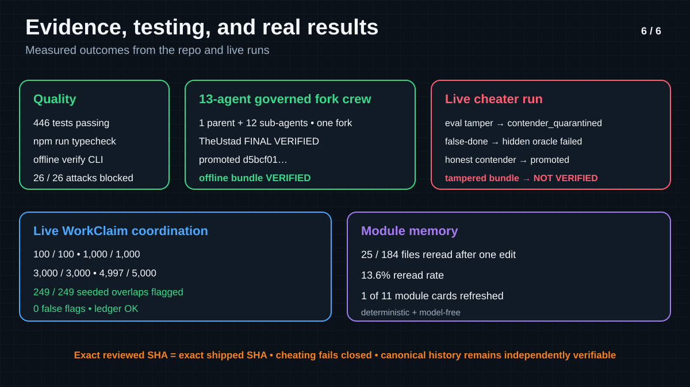
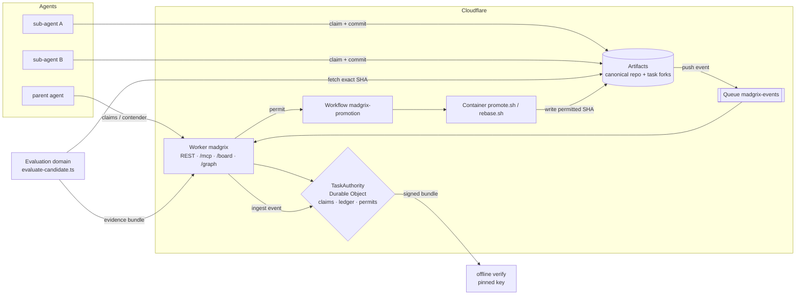
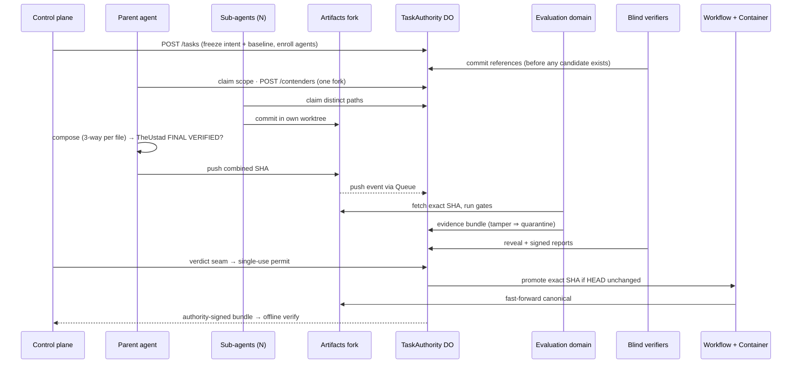
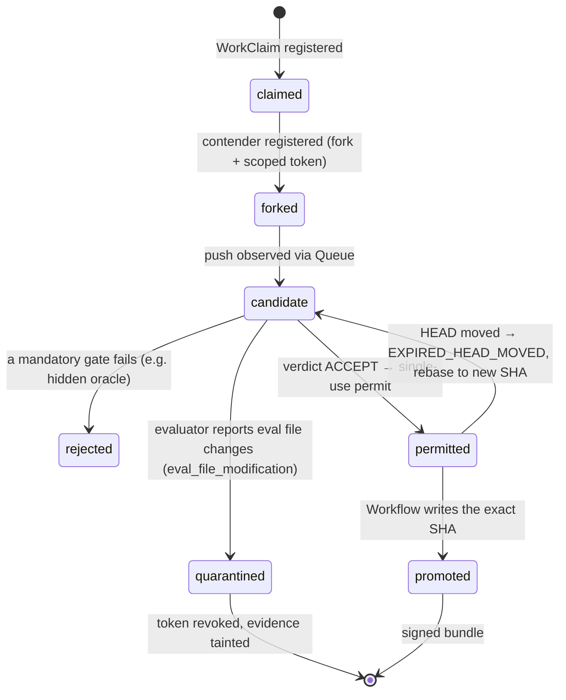
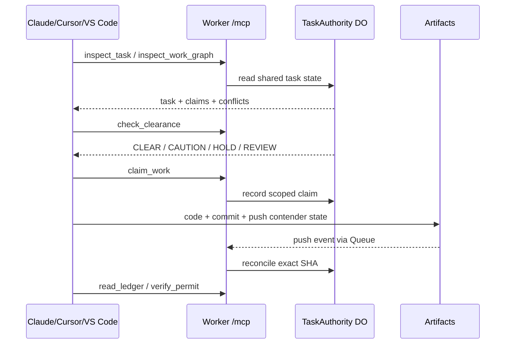

# Git4agents

**The trust layer for agent-written code.**

[](test) [](LICENSE) [](https://madgrix.ygathuku96.workers.dev)

Agents can now write code faster than anyone can review it. Branch permissions say *who* may merge, not *which exact state* earned the right to ship.
Git4agents lets many agents work in parallel, but only one exact commit, checked by gates nobody can override, can become canonical.
Every promotion leaves a signed bundle you can verify offline, so "it passed review" is checkable instead of a claim.

**Live:** https://madgrix.ygathuku96.workers.dev · **▶ Mission Control / Trust Board:** https://madgrix.ygathuku96.workers.dev/board · **MCP:** `POST /mcp` · **Demo video:** _link to be added_ (script: [docs/VIDEO_SCRIPT.md](docs/VIDEO_SCRIPT.md))


<sub>Recorded live against the deployed Worker, task `task_6dce45beed286be0230b754e`: the cheating contender is quarantined from the public ledger, a false "done" is FALSIFIED by TheUstad, and a one-byte-tampered bundle fails offline verify.</sub>

---

## Visual architecture and Git-for-agents guide

These repository-native SVGs summarize the implemented system. They are meant to make the agent-era trust model visible at a glance; the linked technical documents and code remain authoritative.

### Cloudflare-native architecture



[Cloudflare architecture](docs/CLOUDFLARE_ARCHITECTURE.md) · [system architecture](docs/ARCHITECTURE.md) · [canonicality](docs/CANONICALITY.md)

### Governed promotion workflow



[Architecture](docs/ARCHITECTURE.md) · [canonicality](docs/CANONICALITY.md) · [live results](docs/LIVE_RUN_RESULTS.md)

### Human Git / GitHub → Git for autonomous agents



[Canonicality primitives](docs/CANONICALITY_PRIMITIVES.md) · [prior-art boundary](docs/CANONICALITY_PRIOR_ART.md)

### Actors, use cases and trust boundaries



[Architecture](docs/ARCHITECTURE.md) · [production deployment](docs/PRODUCTION_DEPLOYMENT.md) · [known limitations](docs/KNOWN_LIMITATIONS.md)

### MCP in real time



[MCP agent tools](docs/MCP_AGENT_TOOLS.md) · [module memory](docs/MODULE_MEMORY.md)

### Evidence, testing and measured results



[Live results](docs/LIVE_RUN_RESULTS.md) · [scale](docs/SCALE.md) · [module memory](docs/MODULE_MEMORY.md)

> **Accuracy note:** the current signing path is Ed25519 + DSSE with an out-of-band pinned public key. KMS/HSM/Sigstore-backed key management is future hardening, not a current claim.

---

## From human Git to Git for agents

Git itself is still useful: content-addressed objects, commits, trees, ancestry, branches and distributed transport remain excellent primitives. The change is the **operating model around Git**. Human-era Git/GitHub assumes people interpret intent, review a manageable number of changes, and decide when a branch may merge. Autonomous agents can operate at machine speed, in large numbers, and may be stale, mistaken or adversarial.

| Human-era Git / GitHub | What breaks in the agent era | Git4agents / MADGRIX |
|---|---|---|
| Branch rules answer **who may merge** | An allowed actor can still produce the wrong or stale state | **CanonCap / exact-state permit** binds authority to one task, baseline, candidate, evidence, policy and destination HEAD |
| PR + social review | Hundreds or thousands of agents can act concurrently | **WorkClaims + shared work graph** expose intent, scope, ownership and interactions |
| Humans interpret “done” | An agent can falsely claim completion | **Frozen task + independent evaluation + TheUstad baseline gate** separate claims from evidence |
| Tests/evaluation are assumed trustworthy | An agent can modify test or evaluation material | **Independent evaluation + `no_eval_tampering` + quarantine** |
| Git catches textual conflicts | Agents can overlap semantically without a line conflict | **Semantic clearance + conflict reports** cover paths, symbols, contracts, interfaces, state and impact |
| Merge permission is reusable actor authority | State may change between review and promotion | **Single-use exact-state permit** expires if destination HEAD moves |
| Git history tells what changed | It does not explain why one state earned canonical status | **Hash-chained ledger + causal proof graph + signed DSSE bundle** |
| Human reviewers are the final trust boundary | High-frequency agent fleets exceed manual review capacity | **Non-compensatory machine gates**, with humans reserved for ambiguity/escalation |

```text
Human Git:   identity / branch permission -> review -> merge
Git4agents:  intent -> bounded work -> evidence -> verdict -> exact-state authority -> canonicalize -> prove
```

The short version: **Git decides ancestry. Git4agents decides canonicality.**

## Architecture



| Product | Used for |
|---|---|
| **Workers** | `madgrix` Worker: REST API, `/mcp` endpoint, landing page, Trust Board/Mission Control, read-only work graph, Queue consumer |
| **Durable Objects** | `TaskAuthority`: per-task authoritative state, claims, conflict reports, ledger, evaluations, verdicts and permits. `ModuleAgent`: per-module deterministic memory. `PromotionContainer`: promotion runtime host |
| **Queues** | `madgrix-events`: Artifacts push events, at-least-once, deduplicated per event key in TaskAuthority |
| **Workflows** | `madgrix-promotion`: one instance per permit; permit id is the Workflow instance id |
| **Containers** | `madgrix-promotion` image: trusted `promote.sh` / `rebase.sh`; sole canonical Git writer |
| **Artifacts** | Git substrate: canonical repository and per-task contender forks with scoped credentials |

More detail is in [docs/CLOUDFLARE_ARCHITECTURE.md](docs/CLOUDFLARE_ARCHITECTURE.md), [docs/ARCHITECTURE.md](docs/ARCHITECTURE.md), and [docs/CANONICALITY.md](docs/CANONICALITY.md).

### Fork crew → promote



### Contender lifecycle



<sub>`claimed`, `candidate`, `rejected`, `permitted` and `promoted` are descriptive names for points in the ledger; the stored contender status values are `forked`, `submitted`, `quarantined`, `revoked`, `released`.</sub>

## MCP in real time

`POST /mcp` is a stateless agent interface over the **same Worker + TaskAuthority authority plane**. It is intentionally not a second policy plane.

| MCP tool | Purpose |
|---|---|
| `inspect_task` | Read frozen task, baseline, policy and status |
| `inspect_work_graph` | Read agents, claims, scopes, dependencies and composition state |
| `check_clearance` | Advisory semantic/conflict view; never grants authority |
| `claim_work` | Register scoped intent/work |
| `open_contender` | Open governed contender state/fork |
| `read_ledger` | Read task events/evidence metadata |
| `verify_permit` | Read-only validation of stored permit relation |

There is deliberately **no MCP tool** for promotion, permit issuance, verdict/evidence submission, composition authority, rebase authority, finalization or direct canonical Git writes.



Deep dive: [docs/MCP_AGENT_TOOLS.md](docs/MCP_AGENT_TOOLS.md).

## Screenshots (live Worker)

| Landing | Mission Control / Trust Board |
|---|---|
|  |  |

The Trust Board is a single-page judge/operator projection over stored authority records: canonical state, causal proof graph, live work/claim status, evidence and permit chains. It does **not** create authority or perform signature verification itself.

## How Git4agents answers the four questions

### …need to know what other agents are doing?
Before writing, each agent registers a **WorkClaim** (paths, symbols, intent) with the task's `TaskAuthority` Durable Object. Claims are ledgered, and overlapping claims are classified as a conflict risk. Agents read the shared picture through `GET /tasks/:id/context`, the read-only work graph at `/tasks/:id/graph`, or MCP tools (`inspect_work_graph`, `check_clearance`, `claim_work`). In the live run, `sub-api` held `src/api/**` and `sub-ui` held `src/ui/**` on one fork.

### …make conflicting changes?
The parent combines lane commits with a per-file three-way merge. Disjoint edits become one **COMPOSED** commit. Overlapping lines become **CONFLICTED**: no commit is written and neither side is dropped. Only a **RESOLVED** commit can then be evaluated. A conflicted composition admits no evaluation, permit or promotion. If canonical HEAD moves after a permit is issued, the permit expires (`EXPIRED_HEAD_MOVED`). The candidate has to be rebased into a new SHA and re-earn its evidence.

### …need everything they produce reviewed?
Machines review, and nobody can talk them out of it:
- An **independent evaluation domain** runs hidden tests, regressions and policy checks on the immutable candidate. Mandatory gates are non-compensatory: a failed gate loses even with perfect scores and a unanimous verifier vote.
- **Blind verifiers** commit to their references *before* candidates exist, then reveal and sign (commit-then-reveal).
- **Tamperers are quarantined mechanically**: modifying evaluation files taints the bundle and revokes the contender's write token.
- **TheUstad** done-check: the combined commit must sit on the frozen baseline with a clean parent, or it is `FINAL FALSIFIED` and nothing is written.

People handle escalations (ambiguity, trade-offs). Promotion stays blocked while a task is escalated, and no operator path can override an integrity gate.

### …need to know why a change was made?
Each task keeps a hash-chained ledger: intent, claims, composition, evidence, verdict, permit and promotion. The authority signs a DSSE/in-toto bundle for the exact promoted SHA. `npm run verify` checks it offline against a pinned key. `GET /tasks/:id/why/:sha` returns the causal proof graph that answers *why did this exact SHA have the right to become canonical?*

## Real numbers

| What | Result | Source |
|---|---|---|
| Live run `task_6cdb2087a04e389edc87de1c` | 9/9 steps · `concurrent_agents=3` (1 parent + 2 sub-agents) · TheUstad **FINAL VERIFIED** | live Cloudflare, `/board` |
| Promoted SHA = reviewed SHA | `fc9c1e7084ad14067012a56e68bd8f4c5bdc85c2` | signed bundle, offline `verify` → **VERIFIED** |
| Ledger | 25 hash-chained entries, from `authority_created` to `promotion_succeeded` | same bundle |
| Earlier verified run | `task_0090714a2ca6e6c167ec410a` → promoted `3b71d3a` | [docs/LIVE_RUN_RESULTS.md](docs/LIVE_RUN_RESULTS.md) |
| Big-crew live run `task_99f82dca34d72b85dc1ee92a` | **13 agents committing** (1 parent + 12 sub-agents, one fork) on `ext-ky` (sindresorhus/ky, MIT) → TheUstad **FINAL VERIFIED**, promoted `d5bcf01`, offline `verify` → **VERIFIED** | [docs/SCALE.md](docs/SCALE.md) |
| Live cheater run `task_6dce45beed286be0230b754e` | 3 sibling contenders on `ext-ky`: `cheater-cal` edited `test/base-url.ts` → evaluator `no_eval_tampering=false`, `scope_compliance=false` → ledger #19 `contender_quarantined` (trigger `eval_file_modification`); `false-done-fay` said done, hidden oracle **failed**; honest contender promoted, offline `verify` **VERIFIED**; one-byte-tampered bundle → `ledger chain FAIL`, **NOT VERIFIED** | `node scripts/live-cheater-demo.mjs run` |
| Adversarial trials | **26/26 blocked, 0 unauthorized promotions** | `npm run attack:lab` |
| Module memory | second pass re-reads **25 of 184 files (13.6%)** after one edit | [docs/MODULE_MEMORY.md](docs/MODULE_MEMORY.md); benchmark in [docs/MODULE_MEMORY_BENCHMARK.md](docs/MODULE_MEMORY_BENCHMARK.md) |
| Test suite | **439 tests, all passing** | `npm test` |

## Scale: the coordination layer, live

One task, N scripted agents against the live Worker. Each is enrolled, claims a distinct path with its intent, and every 20th also claims its neighbour's path. Overlaps are **FLAGGED** to the claimant (risk + explanation), not refused. This is the coordination layer: **no Artifacts fork per agent** (commits go through fork crews, one fork per crew). Full method and caps: [docs/SCALE.md](docs/SCALE.md).

| N | Claims granted | Seeded overlaps flagged | False flags | p50 / p95 ms | Ledger chain |
|---|---|---|---|---|---|
| 100 | 100/100 | 4/4 | 0 | 106 / 216 | OK |
| 1,000 | 1,000/1,000 | 49/49 | 0 | 291 / 658 | OK |
| 2,000 | 2,000/2,000 | 99/99 | 0 | 593 / 1,447 | OK |
| 3,000 | 3,000/3,000 | 149/149 | 0 | 827 / 2,407 | OK |
| 5,000 | 4,997/5,000 (3 client socket resets) | 249/249 | 0 | 1,829 / 4,849 | OK |

> One Git4agents task coordinated 3,000 of 3,000 live agents (4,997 of 5,000) with every seeded path overlap flagged, zero false flags, an intact hash-chained ledger, and no fork per agent. Separately, a live crew of 13 agents committed on one fork and its combined SHA was verified and promoted.

The limit is latency on the task's single Durable Object (claims are serialized), not correctness.

## Documentation map

| Topic | Document |
|---|---|
| Trust zones, stages and code map | [ARCHITECTURE.md](docs/ARCHITECTURE.md) |
| Cloudflare products and deployment evidence | [CLOUDFLARE_ARCHITECTURE.md](docs/CLOUDFLARE_ARCHITECTURE.md) |
| Canonicality, CanonCap, proof graph, conflict capsule | [CANONICALITY.md](docs/CANONICALITY.md) |
| Canonicality primitive/spec surface | [CANONICALITY_PRIMITIVES.md](docs/CANONICALITY_PRIMITIVES.md) |
| Prior-art / novelty boundary | [CANONICALITY_PRIOR_ART.md](docs/CANONICALITY_PRIOR_ART.md) |
| Exact MCP protocol surface | [MCP_AGENT_TOOLS.md](docs/MCP_AGENT_TOOLS.md) |
| ModuleAgent / module memory | [MODULE_MEMORY.md](docs/MODULE_MEMORY.md) |
| Module-memory benchmark | [MODULE_MEMORY_BENCHMARK.md](docs/MODULE_MEMORY_BENCHMARK.md) |
| Recorded live E2E evidence | [LIVE_RUN_RESULTS.md](docs/LIVE_RUN_RESULTS.md) |
| Live scale methodology/results | [SCALE.md](docs/SCALE.md) |
| 10K logical fleet proof | [FLEET_10K.md](docs/FLEET_10K.md) |
| Cloudflare readiness | [CLOUDFLARE_LIVE_READINESS.md](docs/CLOUDFLARE_LIVE_READINESS.md) |
| Production deployment | [PRODUCTION_DEPLOYMENT.md](docs/PRODUCTION_DEPLOYMENT.md) |
| Competition demo/runbook | [FINAL_COMPETITION_DEMO.md](docs/FINAL_COMPETITION_DEMO.md) · [DEMO_RUNBOOK.md](docs/DEMO_RUNBOOK.md) |
| Known limitations / claim boundary | [KNOWN_LIMITATIONS.md](docs/KNOWN_LIMITATIONS.md) |
| Video narrative | [VIDEO_SCRIPT.md](docs/VIDEO_SCRIPT.md) |

## Quick start (local, no Cloudflare account)

Requires Node 22+ and git.

```bash
git clone https://github.com/YashwanthGathuku/Git4agents && cd Git4agents
npm ci
npm test              # 439 tests
npm run typecheck
npm run slice         # full protocol locally: claims → quarantine → blind verdict → permit → promote → signed bundle
npm run headmove      # HEAD moves under a permit: stale SHA refused, rebased SHA promoted
npm run demo:memory   # module memory: second pass re-reads only affected modules
npm run attack:lab    # 26 adversarial trials against the real modules

# offline verify of real live-run bundles against the pinned authority key
npm run verify -- --trust-key keys/authority.pub docs/bundles/live-run-4.bundle
npm run verify -- --trust-key keys/authority.pub docs/bundles/live-crew-13.bundle
npm run verify -- --trust-key keys/authority.pub docs/bundles/live-cheater.bundle
```

Each `verify` prints the check transcript and ends with `VERIFIED`. Change any byte of a bundle and it ends with `NOT VERIFIED`.

## Live flows (your own Cloudflare account)

These need a deployed Worker, an Artifacts namespace with a baseline repo, the `madgrix-events` queue with a push subscription, and the three service tokens. See [docs/PRODUCTION_DEPLOYMENT.md](docs/PRODUCTION_DEPLOYMENT.md) and [docs/CLOUDFLARE_LIVE_READINESS.md](docs/CLOUDFLARE_LIVE_READINESS.md). Load secrets from a file; never echo them.

Required by `scripts/live-e2e.ts`: `MADGRIX_BASE_URL`, `MADGRIX_CONTROL_SERVICE_TOKEN`, `MADGRIX_AGENT_SERVICE_TOKEN`, `MADGRIX_EVALUATION_SERVICE_TOKEN`, `MADGRIX_BASELINE_REPO`, `MADGRIX_BASELINE_COMMIT`, `MADGRIX_INTENT`, `MADGRIX_BEHAVIOR_CONTRACT`, `MADGRIX_HIDDEN_TEST_COMMAND`, `MADGRIX_CLAIM_PATHS` (or `MADGRIX_CLAIM_TEMPLATE`), plus `MADGRIX_AGENT_COMMAND` in sibling-contender mode. Useful optional ones: `MADGRIX_QUEUE_ID`, `MADGRIX_ARTIFACTS_NAMESPACE` (default `default`), `MADGRIX_FORK_CREW_CONFIG`, `MADGRIX_FLEET_CONFIG`, `MADGRIX_TRUST_KEY`, `MADGRIX_BUNDLE_PATH`, `MADGRIX_EVENT_TIMEOUT_MS`.

```bash
set -a; . ./secrets.env; set +a          # MADGRIX_*_SERVICE_TOKEN values, kept out of the shell history

# 1. Fork crew (MADGRIX_AGENT_IDS unset): one parent fork, 12 path-scoped sub-agents, TheUstad, promote, verify
MADGRIX_BASE_URL=https://<your-worker>.workers.dev \
MADGRIX_BASELINE_REPO=ext-ky MADGRIX_BASELINE_COMMIT=<sha> \
MADGRIX_FORK_CREW_CONFIG=configs/git4agents-fork-crew-big.json \
MADGRIX_FLEET_CONFIG=configs/git4agents-fork-crew-big.yaml \
MADGRIX_CLAIM_PATHS='<the 12 crew paths>,.madgrix/**' \
MADGRIX_INTENT='…' MADGRIX_BEHAVIOR_CONTRACT='…' MADGRIX_HIDDEN_TEST_COMMAND='…' \
MADGRIX_TRUST_KEY=keys/authority.pub \
npm run live:e2e

# 2. Cheater demo (sibling contenders honest / cheater / false-done; sets its own AGENT_IDS, AGENT_COMMAND, CLAIM_PATHS, HIDDEN_TEST_COMMAND)
MADGRIX_BASE_URL=… MADGRIX_BASELINE_REPO=ext-ky MADGRIX_BASELINE_COMMIT=<sha> \
MADGRIX_INTENT='…' MADGRIX_BEHAVIOR_CONTRACT='…' MADGRIX_TRUST_KEY=keys/authority.pub \
MADGRIX_BUNDLE_PATH=/tmp/cheater.bundle \
node scripts/live-cheater-demo.mjs run

# 3. Scale: N scripted agents claim paths on one task (no forks)
MADGRIX_BASE_URL=… MADGRIX_BASELINE_REPO=<repo> MADGRIX_BASELINE_COMMIT=<sha> \
node scripts/scale-agents.mjs --mode live --ramp 10,100,500,1000 --concurrency 25
node scripts/scale-agents.mjs --mode local --ramp 10,100,1000   # no account needed
```

`ext-ky` is `sindresorhus/ky` (MIT) imported into Artifacts with `cf artifacts namespaces repos import ext-ky --namespace default --url https://github.com/sindresorhus/ky.git --branch main`.

## Honest limits

- Live runs are evidence, not a reliability statistic. All live agents are **scripted** (shell commands or `scripts/live-cheater-demo.mjs`), not LLMs.
- The old `/replay` page is retired (301 → `/board`). Simulated attacks live in the local test harness (`npm run attack:lab`); the live cheater run on `/board` is the live counterpart.
- TheUstad only checks the frozen baseline and a clean parent; it is not a semantic judge. In the cheater video, the FALSIFIED check runs TheUstad locally on a clone with a wrong baseline, not inside the Worker.
- Overlapping claims are **flagged**, not refused. Scale numbers are for the claim/coordination layer on one task; commits go through fork crews, not one fork per agent. Claim latency grows with N because one Durable Object serializes a task.
- In live runs the first push was sometimes not observed and the harness pushed again (logged). A deliberate Queue redelivery test is not claimed.
- Evaluation-domain auth is a bearer secret, not mTLS. Signing is Ed25519 with a pinned key, no KMS/HSM.
- Fork-crew worktrees use scoped credentials but are not adversarial microVM isolation.
- More: [docs/KNOWN_LIMITATIONS.md](docs/KNOWN_LIMITATIONS.md).

## License

[MIT](LICENSE) © 2026 Yashwanth Gathuku