# Git4agents

> Public name **Git4agents**. The protocol and implementation are called **MADGRIX**; the deployed Cloudflare Worker is `madgrix`.

**Governed Git promotion for autonomous software agents.** MADGRIX sits between agent-written code and canonical Git so that shipping is an explicit, evidence-backed authority transition rather than “an agent pushed a commit.”

```text
INTENT → work claims → isolated contender work → independent evidence
       → VERDICT SEAM → exact-state permit → canonical promotion
       → signed, offline-verifiable history
```

Git records **what changed**. MADGRIX records **why the work began, what was checked, why a state was authorized, and whether the exact reviewed state is the state that shipped**.

## Live competition status

MADGRIX has completed **four recorded end-to-end runs on real Cloudflare infrastructure**. Each successful run used real Cloudflare Artifacts Git state and push events, the `madgrix-events` Queue, `TaskAuthority`, independent evaluation, the promotion Workflow/Container path, and pinned-key offline verification.

| Run | Task | Baseline | Promoted SHA | Result |
|---|---|---|---|---|
| 1 | `task_0090714a…` | `7d6cb08` | `3b71d3a` | TheUstad `FINAL VERIFIED`, bundle `VERIFIED` |
| 2 | `task_6cdb2087…` | `3b71d3a` | `fc9c1e7` | TheUstad `FINAL VERIFIED`, bundle `VERIFIED` |
| 3 | `task_735cca4a…` | `fc9c1e7` | `b3ee4c86` | TheUstad `FINAL VERIFIED`, bundle `VERIFIED` |
| 4 | `task_79b1f9d6…` | `b3ee4c86` | `d55332b5` | `MADGRIX_LIVE_E2E_OK`, TheUstad `FINAL VERIFIED`, bundle `VERIFIED` |

Each run promoted onto the real `starter-repo` Artifacts `main`; each baseline was the previous run's promotion. **The reviewed/authorized SHA and the shipped SHA were identical in all four recorded successful runs.** Run 4 is the recorded competition source run.

The competition demo crew is **one parent coordinator plus two scripted sub-agents on one contender fork**. Those scripts demonstrate coordination, authorization, evaluation, and promotion; they are not presented as evidence of LLM coding intelligence.

Evidence: [`docs/LIVE_RUN_RESULTS.md`](docs/LIVE_RUN_RESULTS.md) · [`docs/JOURNAL_2026-10-14_LIVE_RUN.md`](docs/JOURNAL_2026-10-14_LIVE_RUN.md)

## Live Cloudflare architecture

```mermaid
flowchart LR
    A[Parent + 2 sub-agents] --> W[MADGRIX Worker]
    W --> R[Cloudflare Artifacts<br/>baseline + contender fork]
    R -->|cf.artifacts.repo.pushed| Q[madgrix-events Queue]
    Q --> T[TaskAuthority Durable Object]
    T --> E[Independent evaluation<br/>+ blind signed reports]
    E --> V[Verdict Seam<br/>exact-state permit]
    V --> F[PromotionWorkflow]
    F --> P[PromotionContainer / Container]
    P --> C[Canonical Artifacts repo<br/>exact reviewed SHA]
    C --> B[Signed promotion.bundle]
    B --> O[Offline verifier<br/>pinned authority key]
    O --> X[VERIFIED]
```



Cloudflare primitives used in the live path:

| Primitive | MADGRIX use |
|---|---|
| **Workers** | HTTP/control surface and Queue consumer |
| **Artifacts** | baseline/canonical Git repository, contender forks, scoped Git credentials |
| **Queues** | real `cf.artifacts.repo.pushed` delivery into the authority path |
| **Durable Objects** | `TaskAuthority`, `PromotionContainer`, deployed `ModuleAgent` |
| **Workflows** | one durable promotion instance per exact-state permit |
| **Containers** | trusted Git writer that fast-forwards canonical state to the reviewed SHA |

Only the promotion path receives canonical write authority.

## Why this exists

Fork-per-agent is becoming commodity infrastructure. The harder problem is **adjudication plus enforcement**:

1. **Intent before action.** Work begins from a frozen task: intent, baseline, behavior contract, and policy.
2. **Bounded authority.** Agents declare WorkClaims and receive credentials scoped to contender state, not canonical Git.
3. **Independent evidence.** Evaluation uses a separate identity and read-only candidate access.
4. **Non-compensatory gates.** Correctness, security, provenance, tamper, or integrity failures cannot be outweighed by style or plausibility.
5. **Blind verification.** Verifiers commit references before candidate exposure, then reveal once and submit signed reports.
6. **Exact-state authorization.** A single-use permit binds task, baseline, candidate/tree digest, evaluation bundle, policy, and destination HEAD.
7. **Exact-state shipping.** The canonical writer promotes the reviewed candidate SHA itself; it does not invent a new merge commit after review.
8. **Proof after shipping.** The authority signs a DSSE `promotion.bundle` whose chain can be verified offline against a pinned public key.

## The 9-step live run

`scripts/live-e2e.ts` intentionally uses the real infrastructure path; it does **not** use `FakeArtifacts`.

```text
1/9 freeze task and verifier identities
2/9 commit blind-verifier references before candidates exist
3/9 parent forks once; sub-agents commit concurrently on that fork
4/9 wait for real Artifacts push events through Queue → TaskAuthority
5/9 evaluate immutable candidate state in the independent evaluation domain
6/9 reveal references and submit signed independent verdicts
7/9 execute Verdict Seam and issue the exact-state permit
8/9 promote the exact reviewed commit to canonical Artifacts state
9/9 fetch the signed bundle and verify it offline against the pinned key
```

### Run 4

- task: `task_79b1f9d610e94d8e95daa503`
- baseline: `b3ee4c862dcc6996678dc25c1de5c49b060fa9d4`
- combined / promoted SHA: `d55332b544992a2e033ca03fa54972c5283eef73`
- crew: parent + `sub-api` + `sub-ui` (3 concurrent process roles, 1 contender)
- TheUstad: `FINAL VERIFIED`
- orchestrator: `MADGRIX_LIVE_E2E_OK`
- offline bundle: `VERIFIED`

TheUstad's role in this fork-crew path is precise: it is a **frozen-baseline integrity gate** that checks the parent repository is still at the expected baseline and clean before composition. It does **not** semantically judge the combined candidate; independent evaluation and the blind-verifier path do that.

Run 3 also showed that the live gates can say **no**: the first attempt was rejected because the declared claim scope omitted `.madgrix/**`. Nothing was promoted. After the claim was corrected, the same gate path admitted the successful run.

## Exact-state promotion

The permit binds the exact state that may ship. The trusted promotion path:

1. reads the permit-bound destination HEAD;
2. fetches the exact winner candidate SHA;
3. recomputes `tree-digest/v1`;
4. rejects tree mismatch or a foreign destination-head move;
5. verifies ancestry;
6. fast-forward pushes the **candidate SHA itself** to canonical `main`;
7. consumes/finalizes the permit only after the canonical write is known to exist;
8. signs the ship record and hash-chained ledger head into `promotion.bundle`.

If destination HEAD moves after verdict, the old permit cannot simply be rebound. The candidate must be rebased to a new SHA and evaluated again before it can receive a new permit. The local head-move harness records this as `HEAD-MOVE OK`.

## Offline verification

`src/cli/verify.ts` trusts only the public authority key pinned out of band (`keys/authority.pub` or `--trust-key`). A key carried by the bundle cannot select itself as trusted.

```bash
npm run verify -- --trust-key keys/authority.pub <promotion.bundle>
```

A successful transcript includes:

```text
subject digest........ OK
candidate digest...... OK
chain integrity....... OK
hidden evaluation..... PASSED
policy digest......... OK
destination base...... OK
authority key......... PINNED
signature............. VALID
permit id............. RECOMPUTED FROM BOUND FIELDS
ledger chain.......... OK

VERIFIED
```

## Local verification

Recommended environment: **Node 24**, npm, Git, Linux/WSL with LF shell scripts. Docker is required for `npm run build` because the build includes the promotion-container image. Older Node 22 builds can require experimental TypeScript support in child processes.

```bash
npm ci
npm run typecheck
npm run build
npm test
npm run slice
npm run headmove
npm run verify -- --trust-key .slice-output/authority.pub .slice-output/promotion.bundle
npm run bench
```

Recorded competition-tree local test result on 2026-10-14:

```text
tests 402
suites 125
pass 402
fail 0
```

The adversarial harness records 26/26 attack trials with `zero_tolerance_ok=true`. These are **local harness/CI claims**, not live Cloudflare fault-injection claims.

## Running the live path

Full setup is in [`docs/CLOUDFLARE_LIVE_READINESS.md`](docs/CLOUDFLARE_LIVE_READINESS.md); that file also preserves an older pre-deployment readiness session, so use [`docs/CLOUDFLARE_ARCHITECTURE.md`](docs/CLOUDFLARE_ARCHITECTURE.md) for current deployment status.

High-level requirements:

- deployed Worker bindings from `cloudflare.config.ts`;
- existing `madgrix-events` Queue and Artifacts event subscriptions;
- a baseline Artifacts repository + exact baseline SHA;
- distinct CONTROL / AGENT / EVALUATION service secrets;
- `AUTHORITY_SIGNING_KEY` whose public half matches the pinned trust key;
- bounded claim paths and evaluation commands.

`live:e2e` runs a preflight before creating a task. Provider-specific coding agents are deliberately not hardcoded; the runner can invoke an external command. The recorded competition evidence uses the scripted fork-crew configuration and is labeled accordingly.

> **Deployment safety:** documentation-only commits do not require a Worker redeploy. If the Worker is deployed again, preserve the existing private secrets file/bindings. One deploy without the secrets file removed the service-token bindings and caused a failed attempt; the subsequent deploy with the secrets restored the working state. Never print or commit secret values.

## Precise non-claims / known limits

- Four successful runs are evidence, **not** a production reliability or scale statistic.
- The recorded sub-agents are scripted commands, not LLMs.
- TheUstad is the frozen-baseline/clean-parent gate described above, not the semantic judge of the combined candidate.
- Real Queue push delivery was observed; a deliberate real at-least-once redelivery test is not claimed.
- Workflow/Container success is live-verified; not every retry/restart/terminate failure branch was fault-injected live.
- Evaluation-domain authentication is a distinct bearer secret, not mTLS/workload identity.
- Competition signing is Ed25519 DSSE with a pinned public key; production KMS/HSM/Sigstore key lifecycle is future hardening.
- The ordinary benchmark is synthetic harness validation, not a real-world accuracy-uplift claim.
- `ModuleAgent` is deployed, but no live module-memory load/wake run is claimed and it does not itself edit code today.
- The recorded fork-crew uses local Git worktrees and scoped credentials; those worktrees are not claimed as adversarial sandbox/microVM isolation.

See [`docs/KNOWN_LIMITATIONS.md`](docs/KNOWN_LIMITATIONS.md) for the longer list.

## Repository map

```text
src/
  worker/index.ts           Worker routes + Queue + PromotionWorkflow
  do/TaskAuthority.ts       authoritative per-task state machine
  do/PromotionContainer.ts  trusted Git promotion container controller
  do/ModuleAgent.ts         module-memory Durable Object
  lib/                      protocol, policy, evaluation, verifier, permit, attestation
  harness/                  deterministic local protocol proofs
  cli/verify.ts             offline promotion-bundle verifier

container/
  Dockerfile
  promote.sh
  rebase.sh
  copy-baseline.sh

scripts/
  live-e2e.ts               real Cloudflare competition path
  run-fork-crew.mjs         parent + sub-agent contender workflow
  run-contenders.mjs        sibling contender runner
  evaluate-candidate.ts     evaluation-domain runner

test/                       unit / integration / adversarial tests
specs/                      frozen engineering contracts + amendments
docs/                       architecture, live evidence, security, demo, runbooks
```

## Key documents

- [`docs/CLOUDFLARE_ARCHITECTURE.md`](docs/CLOUDFLARE_ARCHITECTURE.md) — current deployed architecture/status
- [`docs/LIVE_RUN_RESULTS.md`](docs/LIVE_RUN_RESULTS.md) — with/without comparison + all four live runs
- [`docs/JOURNAL_2026-10-14_LIVE_RUN.md`](docs/JOURNAL_2026-10-14_LIVE_RUN.md) — deadline-day live-run journal
- [`docs/DEMO_SCRIPT.md`](docs/DEMO_SCRIPT.md) — final 5–10 minute competition video script
- [`docs/KNOWN_LIMITATIONS.md`](docs/KNOWN_LIMITATIONS.md) — current limits and non-claims
- [`docs/SECURITY.md`](docs/SECURITY.md) — threat model / attack handling
- [`keys/README.md`](keys/README.md) — pinned authority-key model

## License

MIT — see [LICENSE](LICENSE).
